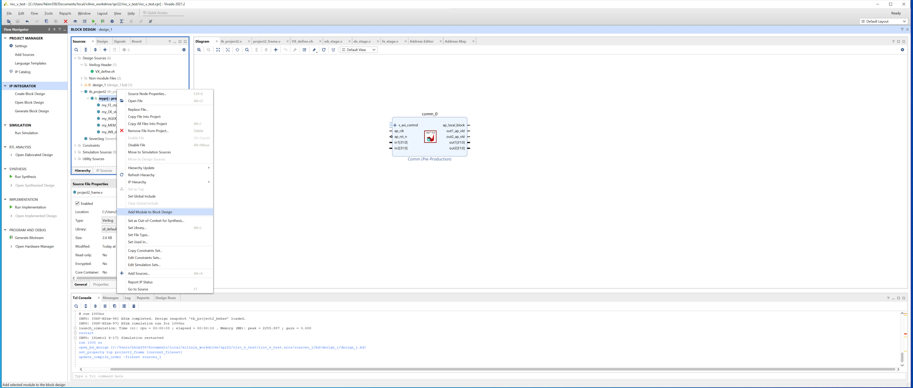
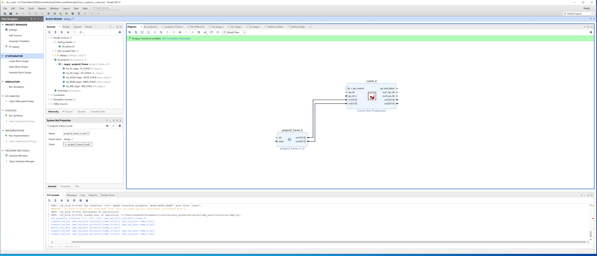
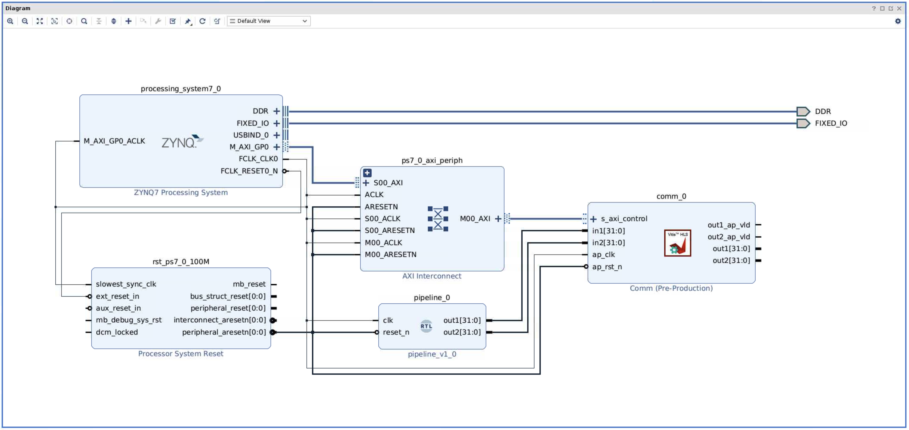

# CS3220 Lab #5

In this lab, you will deploy your RISC-V processor on a Pynq board and deepen your understanding of IO protocols.


**Learning Outcomes:**

+ Develop proficiency in creating and utilizing AXI lite ports for communication with your RISC-V processor.

+ Gain hands-on experience with the Vivado and Vitis HLS workflow to deploy hardware designs on FPGAs.

**Lab Structure:**

+ **Part-1:** Step-by-step guidance on using AXI lite for communication with your RISC-V processor.

+ **Part-2:** Apply your knowledge to send instructions to your processor using external inputs via AXI lite.

**Grading:**

+ **Part 1 (In-Class): Deploy your RISC-V CPU on the Pynq Board**: 100 points

+ **Part 2 (Take-Home): Dispatch Instructions to Your Processor with AXI Lite**: 100 points

The point distribution and grading weights for each part are determined by **Canvas**. Refer to the corresponding Canvas assignment for the official grading breakdown.

## Part-0: Environment Setup

### Remote Desktop for Vivado and Vitis

You will use Vivado and Vitis HLS 2022.2 in this lab. Access the remote desktop for the best experience, where all necessary toolchains are pre-installed on PACE ICE Clusters. Follow the same instruction in lab0 to access PACE ICE [document](https://docs.google.com/document/d/1_1TUXBpvabmKU22H2CNZOGCGa-sgre33HpsFtOXev1k/edit?usp=sharing).

### Updalod/Download Files to/from the Remote Desktop

Click Session ID in step 4 of the above document, then click "Home Directory" on the left, you will be able to upload/download files to/from the PACE ICE Cluster (e.g., upload your Verilog files and download the generated bitstream).

### Accessing Pynq Board

We've settled remote access to the pynq board. Please follow the [instructions](https://docs.google.com/document/d/1Vgq4hqg2PBhlwCA1yLPD7siiIVJK4tD1NS8vMTlKJ7w/edit?usp=sharing).
 

Note: Environment setup may take some time. Please be patient. Remember, the availability of Pynq boards is limited; ensure your remote session does not exceed 2 hours.

## Part-1: Deploy your RISC-V CPU on the Pynq Board

In this part, you will deploy your RISC-V processor on a pynq board. The pynq board contains a [field programmable gate array (FPGA)](https://en.wikipedia.org/wiki/Field-programmable_gate_array), which allows you to program its hardware. You will be able to communicate with the board through AXI lite ports using either a Jupyter notebook or an SSH/Python script.

### Step-1: Vitis for Creating a Communication Adapter

Use [comm.cpp](comm.cpp) in Vitis HLS to generate a communication adapter. This code defines ports (inputs and outputs) for Verilog modules, facilitating memory-mapped connections via AXI lite protocol. Vitis will automatically generate most of the necessary logic.

For a detailed, step-by-step demonstration, refer to this [video](https://drive.google.com/file/d/1HoN1HT4EVyJ_2OS1ITIxDAKuInt-Zqa_/view?usp=sharing).

### Step-2: Vivado for Bitstream Generation

#### [1] Code Preparation:

Modify [pipeline.v](pipeline.v)  include two additional ports and change the reset to reset_n.

Before:

```
module pipeline (
  input wire clk,
  input wire reset
);
```

After:

```
module pipeline(
input clk,
input reset_n, 
output[31:0] out1,
output[31:0] out2
);


wire reset = ~reset_n;  
```

In [pipeline.v](pipeline.v), connect `out1` for cycle count:

``` 
always @ (posedge clk) begin
  if (reset) begin
    cycle_count <= 0; 
  end else begin
    cycle_count <= cycle_count + 1;    
  end
end

assign out1 = cycle_count;
```

Assigned `out2` to the 10th register:

```
assign out2 = reg10_val;  
```

#### [2] Create a Block Design

Create a Vivado project and a block diagram. Import the IP repository (communication adapter) from Step 1 and add the comm IP to the block diagram. For a step-by-step demonstration, see this [video](https://drive.google.com/file/d/1b_g4ebtIzH13NdVNM_ZZ0DmKQ0fBnCP6/view?usp=sharing).

#### [3] Add the RISC-V Processor to the Block Diagram

 

#### [4] Connect Modules

You will need to connect your RISC-V processor with the communication adapter (in1 in common <-> out1 in RISC-V, in2 in common <->out2 in RISC-V) manually. 
 

#### [5] Add Zynq PS Module

The procedure for adding the Zynq PS module is the same as how you add the "comm" IP into the block diagram (you do not need to import new repo, Vivado has automatically loaded it for you), this time you need to search "zynq" instead of "comm". The PS stands for the on-chip processing system (where you run the jupyter notebook), which will communicate with the RISC-V processor through AXI lite.

The autoconnect button shows up at the top of the block diagram. Click "Run Connection Automation" and then select all modules, then click OK.

If clock or reset signal connections are missing, you can connect them manually. The final output should look like the following:
 

#### [6] Create HDL wrapper 

Go to the “Sources” panel and right click on your block design (named "design_1"), click on “Create HDL wrapper”. Click on “Let Vivado manage wrapper and auto-update” option and click on “OK”. 

Make the design_wrapper (named "design_1_wrapper") as the *top module* by right click it in the source code and choose "Set as Top". 

#### [7] Synthesize/implementation/generate bitstreams

Go to the "Flow Navigator" panel and click "Generate Bitstream" (it will ask to synthesize etc., click yes). The bitstreams tells FPGA how to program its hardware.

The bistream generation takes around 10 mins, in the bottom of the screen, if you select "Design Runs", you can see the progress.

#### [9] Export the bitstream

Click on File -> Export -> Export bitstream.

#### [10] Prepare the files

Copy the following files from your Vivado project folder:
+ `[proj_name].runs/impl_1/design_1_wrapper.bit` or where you expored the bitstream in step [9].
+ `[proj_name].runs/impl_1/design_1_wrapper.tcl`
+ `[proj_name].gen/sources_1/bd/design_1/hw_handoff/design_1.hwh.`
to the same folder.

The name and path may be different if you use different block design name, all the paths are relative path to the project root (where you created the Vivado project).

Make sure you rename all the files to have the same name (e.g. riscv.bit, riscv.tcl, riscv.hwh).

### Step-3: Deploy and Verify on the Pynq Board

Follow the current [CS3220 PYNQ Board Access Guide](https://docs.google.com/document/d/1Vgq4hqg2PBhlwCA1yLPD7siiIVJK4tD1NS8vMTlKJ7w/edit?tab=t.0). **Either verification method below is accepted.** Do not use the old Piazza post 140 instructions.

**Option A — Jupyter Notebook:** Upload the matching `riscv.bit`, `riscv.hwh`, and `riscv.tcl` files and [riscv_test.ipynb](riscv_test.ipynb) to the same PYNQ directory. Load the overlay and execute the notebook cells.

**Option B — SSH / Python:** Connect to the GT VPN, then obtain a PYNQ board through Slurm:

```bash
ssh <GT_USERNAME>@fry.cc.gatech.edu
srun -p techfee -C pynq -N 1 --mem=200M --pty /bin/bash -l
sudo -s
source /usr/local/share/pynq-venv/bin/activate
python riscv_test.py
```

Transfer the matching `.bit`, `.hwh`, `.tcl`, and [riscv_test.py](riscv_test.py) to the allocated board and run the script from the same directory. If your board allocation or permissions prevent execution, contact the course staff or IT.

**Verification:** In the provided design, offset `0x20` reads `out1` (cycle count) and `0x30` reads `out2` (register `x10`). `out1` should change as cycles advance; `out2` shows the current value stored in `x10`. Capture **one screenshot** of the actual notebook or terminal output and briefly explain the observed values. The Student ID last-digit requirement applies to **Part 2**, not Part 1.

## Part-2: Dispatch Instructions to Your Processor with AXI Lite

In Part 1, you learned to add output ports to your RISC-V processor and read values using AXI Lite. Real-world applications often require both reading outputs and sending inputs to the processor. In Part 2, you will:

1. Add an input port to your RISC-V processor.;
2. Dispatch instructions to your processor and verify the execution results.

### Step-1: Revise Your Code

Similar to Step-2 in Part-1, you will begin by adding a 32-bit input port to [pipeline.v](pipeline.v). Next, assign this input value to `inst_FE` in [fe_stage.v](fe_stage.v), so that the processor takes the input as the instruction.

### Step-2: Bitstream Generation

The bitstream generation process for the revised RISC-V design mirrors that of Step-2 in Part-1. The only difference is that you now need to connect the newly added input port to the communication adapter.

### Step-3: Deploy and Verify on the Pynq Board

Generate a **new, matching** `.bit`, `.hwh`, and `.tcl` set for the updated design, using a common base name (for example, `riscv2.bit`, `riscv2.hwh`, and `riscv2.tcl`). Follow the same [PYNQ Board Access Guide](https://docs.google.com/document/d/1Vgq4hqg2PBhlwCA1yLPD7siiIVJK4tD1NS8vMTlKJ7w/edit?tab=t.0) and choose **either** Jupyter with [riscv_test2.ipynb](riscv_test2.ipynb) or SSH/Python with [riscv_test2.py](riscv_test2.py), as described in Part 1. Run your test from the directory containing the matching overlay files.

### Step-4: Dispatch Instructions and Verify Your Student ID Digit

Write one or more valid RISC-V instructions through your new AXI-Lite instruction input so that **register `x10` (`out2`) equals the last decimal digit of your own GT Student ID**. You may use **any supported instruction or instruction sequence** that achieves the required result. Use this [online RISC-V assembler](https://riscvasm.lucasteske.dev/#) if needed to convert assembly to machine code.

For example, if the last digit of your ID is `7`, `addi x10, x0, 7` (machine code `0x00700513`) is one possible instruction, and the expected `out2` is `7`.

Modify the provided test notebook or Python script to write your instruction(s) to the **correct writable AXI-Lite register offset** found in your generated Vitis HLS register map, then read `out2`. The provided design uses offset `0x30` for `out2`; check the generated mapping if your adapter differs. **Writing the instruction alone is not enough:** confirm the processor actually executes it and the measured `x10` matches your required digit. Show the instruction(s), actual output, and expected digit in your verification screenshot. Do not include your complete Student ID in the screenshot or report.

## Submission Guideline

Submit **one ZIP for each part** to its corresponding Canvas assignment. The same PYNQ verification methods (Jupyter or SSH/Python) are accepted for both parts.

**Part 1 — In-Class (100 points):**

1. **One screenshot** showing the complete Vivado Block Design and its connections.
2. The three matching overlay files: `.bit`, `.hwh`, and `.tcl`.
3. **One screenshot** of the actual PYNQ Jupyter notebook or terminal output showing `out1` and `out2`.
4. A **brief explanation** of the observed cycle count and register `x10` results.

**Part 2 — Take-Home (100 points):**

1. **One screenshot** showing the complete **updated** Vivado Block Design, including the new instruction input connection.
2. The three matching **updated** overlay files: `.bit`, `.hwh`, and `.tcl`.
3. Your **modified verification script** (`.py` or `.ipynb`) that sends the instruction(s) and reads the result.
4. The **assembly instruction(s) and corresponding machine code** used in your test (include these in the report or clearly in the test script).
5. **One screenshot** showing your actual PYNQ notebook or terminal result, demonstrating that `out2` (`x10`) equals the **last digit of your own GT Student ID**.
6. A **short report** explaining which RTL, HLS communication adapter, Vivado connections, and verification code you modified, and how you confirmed successful execution. Do not include your full Student ID.

**Grading policy:** Each part is graded out of **100 points**. The **official item weights and grading criteria are those posted on Canvas** for the respective assignment; the README does not override Canvas. A successful bitstream deployment by itself does not satisfy all submission requirements.
