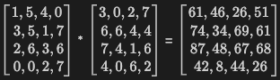
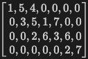
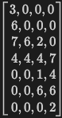
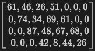
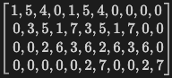
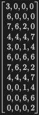
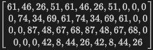

# CS3220 Lab #6 In-Class 1: 2x2 Systolic Array

**In-Class 1: 20 pts.**

Lab 6 points:

| Portion | Points |
|---|---|
| In-Class 1: 2x2 Systolic Array | 20 pts |
| In-Class 2: NxN Systolic Array | 20 pts |
| Take-Home Part A: MxN Systolic Array (`N` = `K`) | 15 pts |
| Take-Home Part B: General-sized Systolic Array (`N` != `K`) | 15 pts |
| Take-Home Part C: AXI-Stream Interface | 15 pts |
| Take-Home Report | 15 pts |
| **Total** | **100 pts** |

In this lab, you will explore the design of a systolic array. Systolic arrays, first introduced in the late 1980s, have since become a fundamental tool for a wide range of applications, spanning from scientific computing to machine learning. The core concept revolves around employing a regular grid of simple processing elements (PEs) to execute computations in a data-flow fashion. These PEs are interconnected in a structured manner, facilitating the streaming of data through the array. The systolic array architecture excels in efficiently handling tasks such as matrix multiplication, convolution, and other linear algebra operations. An exemplary illustration of this concept can be found in the Google TPU, which leverages systolic arrays and vector machines. One of the major key features of systolic arrays is the systolic data propagation, which is a very efficient and scalable way to move data through the array, which we will focus a lot in this lab.

This session is In-Class 1: you will build a 2x2 systolic array.

## Systolic Array Overview

In this session, you'll implement a 2x2 systolic array, with output stationary design. We will focus only on the matrix multiplication operation.

**IMPORTANT!! Otherwise you will be lost during this lab! Please be sure to read through the original systolic array paper before you start:**

- [link1](https://www.princeton.edu/~kung/papers_pdf/New%20Folder/VLSI%20Array%20Processors.pdf)

To enhance your comprehension and offer more specific guidance on implementation, we have included a tutorial report detailing the systolic array design and implementation. This report will direct you on where to begin and outline the necessary steps:
- [link2](CS3220_systolic_array_luke_zhang.pdf)


### Problem Description


The code skeleton is provided in:
- [systolic_array.v](../code/systolic_array.v)
- [MAC.v](../code/MAC.v)
- [ctrl.v](../code/ctrl.v)
- [adder.v](../code/adder.v)
- [multiplier.v](../code/multiplier.v)
- [synchronus_fifo.v](../code/synchronus_fifo.v)


Out of the above files, you will need to work on [systolic_array.v](../code/systolic_array.v), [MAC.v](../code/MAC.v), and [ctrl.v](../code/ctrl.v) to complete the systolic array design.


Finish all the TODOs in the code; or you can start from scratch if you prefer. The only major requirement is that you are not allowed to change the interface of the systolic array [systolic_array.v](../code/systolic_array.v). Although we provide the interfaces for [MAC.v](../code/MAC.v) and [ctrl.v](../code/ctrl.v), you are free to change them as you see fit.

Todos in the skeleton codes provided are intended to guide you through the implementation process and provide some hints. However, you are free to modify the code as you see fit.

**Note:** The Makefile only compiles the files listed above. If you write a helper module (for example, a delay line), put it inside [MAC.v](../code/MAC.v) or [ctrl.v](../code/ctrl.v). Do not create a new `.v` file for it.


Useful hints:
- Pay very special attention to the timing of the signals. At what clock cycle should the signals be expected?
- What if two signals are expected to arrive at the same time? But one of them is a little falling behind? Remember Flip-Flop is a very useful tool to help you with this; output of a Flip-Flop is always one clock cycle behind the input; can you use this to help you with the timing?
- When debugging, start with small sized systolic array, and zoom in into a single MAC unit. This will help you understand the timing of the signals.
- More hints may be available in the code skeleton, please read through them carefully.


### Testing Procedures

Testing pattern and assumptions:
- The input data will be pre-skewed and pre-rotated. You don't need to implement the skewing and rotating logic. For example:
    - For matrix multiplication A*B=C:

    - A: Streamed to ```row_data_in``` [systolic_array.v](../code/systolic_array.v) from left to right as (note topmost is the first row): 
    - B: Streamed to ```col_data_in``` [systolic_array.v](../code/systolic_array.v) from top to bottom as (note leftmost is the first column): 
    - C: Expected to be streamed out from ```row_data_out``` [systolic_array.v](../code/systolic_array.v) from left to right as (note topmost is the first row): 
- Multiple matrix multiplication operations will be performed in sequence. Your design is expected to be able to handle the next matrix multiplication operation immediately after the previous one is finished.
    - Assume the same matrix multiplication operation as above is performed again, the input data will be streamed in the same way as above.
    - A: Streamed to ```row_data_in``` [systolic_array.v](../code/systolic_array.v) from left to right as (note topmost is the first row): 
    - B: Streamed to ```col_data_in``` [systolic_array.v](../code/systolic_array.v) from top to bottom as (note leftmost is the first column): 
    - C: Expected to be streamed out from ```row_data_out``` [systolic_array.v](../code/systolic_array.v) from left to right as (note topmost is the first row): 

**Notation**

The lab computes C = A × B on an M × N systolic array.
- **M**: rows of A and C, and rows of the array (`ROWS`)
- **N**: columns of B and C, and columns of the array (`COLS`)
- **K**: columns of A and rows of B. Each PE sums K products, and each matrix multiplication takes K input cycles (`K`).

So A is M × K, B is K × N, and C is M × N.

Example: `ROWS=2 COLS=4 K=2` means A is 2×2, B is 2×4, C is 2×4, on a 2×4 array.

Test script, a `NUM` number of random tests of A (`M`x`K`) * B (`K`x`N`) matrix multiplications will be performed, on systolic array with size `M`x`N`. You can run the test script by:

```
make systolic_array ROWS=${M} COLS=${N} K=${K} NUM_TESTS=${NUM}
cat results.log | grep PASSED
```

How a test runs (`make systolic_array`):
1. `data_gen.py` makes random A and B, pre-skews them, and writes the expected C.
2. Verilator turns your Verilog into a C++ model and builds it with the testbench, `test_systolic_array.cpp`.
3. The testbench drives one input beat per cycle and records `row_data_out` every cycle. It also writes `trace.vcd`.
4. `data_gen.py` compares your output with the expected C and writes PASSED or FAILED to `results.log`.

All code files are in the [code/](../code) folder. Run every command from inside it:

```
cd code
source init.sh
```


## How the Array Works

The in-class slides walk through a 2x2 example cycle by cycle. In short:

**Dataflow**
- PE(i,j) stays in place and owns one output, C[i][j].
- A's rows move right and B's columns move down, one PE per cycle.
- PE(i,j) gets its first pair `i + j` cycles after PE(0,0).
- Matrix multiplications arrive back to back, every `K` cycles, with no gap.

**The two control signals**

| Signal | The testbench sends it | `ctrl.v` delays it until | Then the PE |
|---|---|---|---|
| `rst_accumulator` | With the first input of each matmul (`counter % K == 0`) | The first product reaches the adder | Starts a new sum from that product |
| `stream_out_rdy` | With the last input of each matmul (`counter % K == K-1`) | The last column's sum is done | Sends its own result, then forwards its right neighbors' results |

- The testbench ignores `MULT_LAT`. All latency compensation is in `ctrl.v`.
- `ctrl.v` drives the top row only: bit `j` goes to PE(0,j). Each MAC passes both signals to the MAC below it, 1 cycle later.

**Inside one MAC**
- Product path: multiplier (`MULT_LAT` cycles), then a product register (1 cycle), then the adder.
- The next matmul starts right away and overwrites the accumulator. So the MAC keeps a short history of past sums (`psum[0]`, `psum[1]`, ...), and `OWN_DELAY` picks the one from when this column finished.

**Getting results out**
- Results leave the array only from column 0, one value per row per cycle. No large output mux.
- On `stream_out_rdy`, every PE sends its own result. For the next `COLS - 1` cycles (the bypass counter), it forwards results from its right.
- Row 0 comes out as C[0][0], C[0][1], ... Row `i` comes out 1 cycle after row `i - 1`.


## In-Class 1 Task (20 pts)

Implement a 2x2 systolic array with `K` = 2 by completing the TODOs in [MAC.v](../code/MAC.v), [ctrl.v](../code/ctrl.v), and [systolic_array.v](../code/systolic_array.v). Much of the code is already written for you, so you can focus on the timing.

| File | What it does | Provided | Your TODOs |
|---|---|---|---|
| [systolic_array.v](../code/systolic_array.v) | Top level. Registers the testbench inputs, holds the 2x2 grid of MACs, and wires each MAC to its neighbors. Results leave the array from column 0. | Input registers, `ctrl` instance, wires between MACs, 4 MAC instances, PE(0,0) fully connected as a worked example | Connect PE(0,1), PE(1,0), and PE(1,1); drive `row_data_out` for row 1; set `OWN_DELAY` for each column |
| [MAC.v](../code/MAC.v) | One processing element. Each cycle it multiplies its row and column inputs and adds the product to its running sum for C[i][j]. It passes its inputs right and down, and when told to, sends its own result (or its right neighbor's) to the left. | Multiplier and adder instances, the registered product, the shift register that holds the MAC's own result, and an explanation of how stream-out works | Both adder inputs (new product, and reset or accumulate); pass-through registers to the next MACs; `stream_started`, the bypass counter, and the output mux (own result or right neighbor's) |
| [ctrl.v](../code/ctrl.v) | Takes the testbench's start pulse (`rst_accumulator_rdy`) and end pulse (`stream_out_rdy`) and delays them, so each column sees them on the right cycle. | Both delay chains | The two delay amounts, `RST_DELAY` and `STREAM_OUT_DELAY` |

Fixed numbers that work for a 2x2 array with `MULT_LAT` = 3 are fine.

Test command: `chmod +x run_inclass1.sh && ./run_inclass1.sh`

| ROWS x COLS | K | MULT_LAT | NUM | SEED |
|---|---|---|---|---|
| 2 x 2 | 2 | 3 | 100 | 1, 2, 3, 4, 5 |

Expect 5 passes. Each passing test is worth **4pts**.

To run a single test case:

```
make systolic_array ROWS=2 COLS=2 K=2 NUM_TESTS=100 SEED=1
cat results.log | grep PASSED
```


## Debugging Tips
- Every build dumps a waveform to `trace.vcd`. Open it with the Signal Viewer extension, or download it and use GTKWave.
- On a FAILED test, open `results.log`. It prints the expected (`Gold`) and actual (`Result`) output streams.
- The checker finds the first expected output row, then the last one, and compares everything in between. Leading zeros before your first result are fine, but a bubble or wrong value between results fails the test.
- `run_inclass1.sh` runs its tests one after another, so `trace.vcd` and the `.bin` files are from the last test only. To debug a specific failing test, rerun it on its own with `make`.
- Always name a target (`make systolic_array`). Plain `make` does not work.

Check your design in this order, in `trace.vcd`:
1. **Pass-through:** PE(0,1) sees PE(0,0)'s row data 1 cycle later; PE(1,0) sees its column data and control signals 1 cycle later.
2. **Reset:** `rst_accumulator_in` is high on the same cycle `adder_in_A` holds the first product of a matmul.
3. **Sums:** each `adder_out` reaches the right C[i][j] value. Work one out by hand for PE(0,0).
4. **Stream-out:** on the `stream_out_rdy_in` cycle, `psum[OWN_DELAY]` holds the finished sum, not part of the next matmul.
5. **Output:** `row_data_out` shows each row in column order, back to back.

If a step fails, the problem is usually in the step before it.


## Rules and Potential Violations
1. adder and multiplier instances have to be used and used as they are
2. systolic array IOs **and** default parameters cannot be changed
3. for MAC's parameters, as long as we can pass the MULT_LAT parameter in from the top module (systolic_array.v), it's fine
4. Any changes to Makefile, test*.cpp, adder and multiplier module definition will not be considered
5. Helper modules must be placed in MAC.v or ctrl.v. Do not add new `.v` files


## FAQ
[Q] Useful lecture links for systolic array design?

https://www.youtube.com/watch?v=cmy7LBaWuZ8&pp=ygUPc3lzdG9saWMgYXJhYXkg
